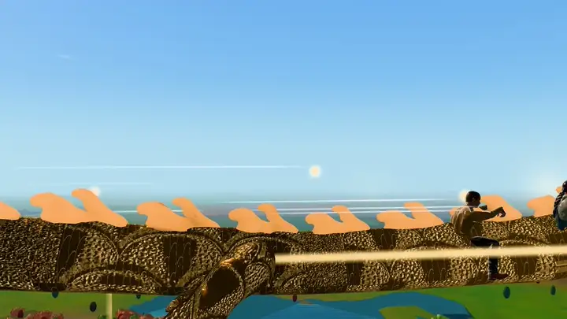

# Contributing

<p align="center"></p>
<p align="center"></p>

Thanks for helping. This is a game and also a template people use to make
something personal, so when I review a change I look at two things: does the
world still play well, and is it still easy and safe to personalize?

## Set up

```bash
git clone https://github.com/xIBBAx/somewhere-for-you.git
cd somewhere-for-you
npm ci
npm run dev          # http://localhost:5173 (add ?debug for QA tools)
```

Node.js 20.19+ or 22.12+. On WSL with the project on a Windows drive, start
the dev server with `WATCH_POLLING=1 npm run dev` (see
[docs/DEVELOPMENT.md](docs/DEVELOPMENT.md)).

## Before you open a pull request

```bash
npm run check        # typecheck, lint, unit tests and a production build
npm run test:e2e     # browser tests (needs: npx playwright install chromium)
```

Then look at your change in the running game. A visible change (a new
effect, an animation, a UI change) needs a screenshot or a short clip in the
pull request. Use the default demo world, never your own photos.

## Workflow

1. Open an issue first for anything bigger than a small fix, so we can agree
   on the approach before you spend time on it.
2. Branch from `main` (`fix/…`, `feat/…`, `docs/…`).
3. Keep each pull request to one change. Refactors go in their own pull request.
4. Write commit messages in the imperative, describing what the change does
   for the player or the developer: "Let the cat follow you onto the bridge",
   not "fix bug". [Conventional Commits](https://www.conventionalcommits.org/)
   prefixes (`fix:`, `feat:`, `docs:`) are welcome but not required.
5. I'll review it, maybe ask for changes, and squash-merge it.

## Code conventions

- TypeScript strict mode; no `any` without a comment saying why.
- Read the module's header comment before changing it; most explain the
  physics or the reasoning behind their numbers. Keep them true when you
  change behaviour.
- Per-frame code avoids allocations (reuse vectors and quaternions); tests
  check the animation hot path for this.
- Player-facing names come from the personalization (`names.cat`,
  `names.starborn`, `characterName(id)` from `src/personalization`), never
  hard-coded. Never write people's names, dates or places into code or
  content.
- Player-facing text is plain and short. No HTML from data, ever.
- Tests live in `tests/` (Vitest) and `tests/e2e/` (Playwright). Add or update
  a test with every behaviour change you can test without a GPU.

## Assets

Every model, texture, sound or font must be redistributable in a public
repository:

- Accepted: CC0, public domain, CC BY 4.0, CC BY-SA 4.0, or your own work
  released under this repo's MIT licence.
- Not accepted: non-commercial or no-derivatives licences, Mixamo or
  marketplace assets that forbid stand-alone redistribution, AI-generated
  assets whose terms are unclear, anything without a clear source, and photos
  or likenesses of real people.
- Add the source, author, licence and any changes you made to
  [ASSET_LICENSES.md](ASSET_LICENSES.md) in the same pull request.
- Keep files small: `.glb` with WebP textures, 2048 px at most (1024 for most
  things), and LODs for anything that appears more than a few times. The
  repository must stay usable with a normal `git clone` (no Git LFS).
- Characters must follow the rig in [docs/CHARACTER_ASSETS.md](docs/CHARACTER_ASSETS.md);
  new animals and props should come with the script that builds them in
  `asset-pipeline/` when that is possible.

## Privacy

Never commit a `customize/gift.json`, anything in `customize/media/`, an
exported world `.zip`, `.env` files, keys or screenshots that show personal
content. `.gitignore` covers the usual places; check `git status` anyway.

## Bugs and ideas

- **Bugs:** open an issue with the *Bug report* form: what you did, what
  happened, what you expected, your browser, GPU and the console output. A
  screenshot of the debug line (`?debug`) helps.
- **Features and gameplay ideas:** open an issue with the *Feature idea*
  form. Describe what the player would do and feel, not only the
  implementation. Ideas that keep the world calm and easy to personalize fit best.
- **Security problems:** see [SECURITY.md](SECURITY.md); don't open a public issue.

By contributing you agree that your contribution is under this repo's
[MIT License](LICENSE) (and, for assets, the licence you put in
`ASSET_LICENSES.md`).

---

<sub>Somewhere, For You created by <a href="https://github.com/xIBBAx">Ibrahim Sultan</a>.</sub>
