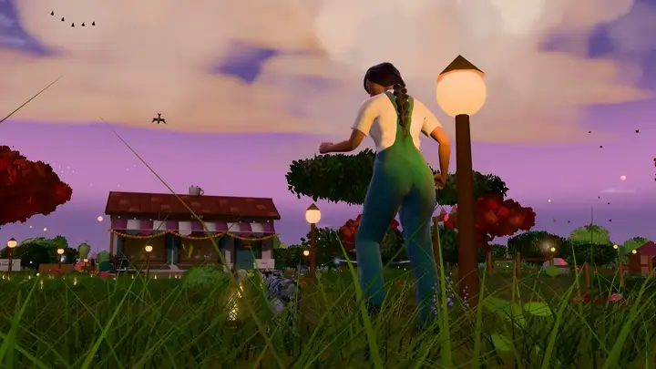

# Privacy

This game runs entirely in your browser. It has no server, no accounts, no
analytics, no advertising and no tracking. This page lists everything it
stores and the one thing it can send over the network.

## What leaves your browser

**Nothing, unless you turn on live weather.** Out of the box the game
downloads its own files from wherever it is hosted and makes no other
requests.

**Live weather (off by default).** If the world's settings turn on live
weather (Personalize → World, or `"liveWeather": true` in `gift.json`), the
browser asks for permission to share your location. With permission, the
coordinates, rounded to about 1 km, are sent to
[Open-Meteo](https://open-meteo.com/) to fetch the local weather. Without
permission, the world's "home" location is used instead. Open-Meteo's own
privacy terms apply to that request. Turn live weather off and no request is
made.

Nothing you add in the Personalize screen (names, letters, photos, music,
models) is ever uploaded: not to the host, not to GitHub, not to any AI or
image service.

## What is stored on your device

All of it stays in this browser, for this site only (other sites cannot read
it). You can delete it at any time.

| What | Where | Key or name |
|---|---|---|
| Your personalized words and settings | localStorage | `gift-world/personal/v1` |
| Photos, music and character models you added | IndexedDB | database `gift-world-personal` |
| Progress: stars, journal pages, photo-mode album, map marks, settings | localStorage | keys starting with `gift-world/` and `gift-world.` |
| "Already in the world" for this tab, so a refresh skips the letter | sessionStorage | `gift-world/in-world`, `gift-world/refresh` |
| The last live weather reading, only when live weather is turned on | sessionStorage | `gift-world/weather-v1` |

Photos you add are decoded and redrawn before they are stored, which removes
their EXIF data, including any GPS location the camera recorded. They are kept
at up to 1600 pixels on the long side.

## Deleting it

- **Personalized content:** Explore → Personalize this world → Your data →
  *Delete everything personal from this browser*. This removes the words,
  photos, music and models above.
- **Progress:** Personalize → Your data → *Start the journey over* (keeps your
  personalization), or clear the site's data.
- **Everything:** your browser's settings for this site (*Clear site data* /
  *Cookies and site data*). A private or incognito window keeps nothing after
  it closes.

## When you share a world

- An **exported `.zip`** contains your words and your files in full. Treat it
  like the photos inside it.
- A **built copy** (`npm run build` with `customize/`) includes every file you
  referenced. Anyone who can open the link can download them, so host it only
  where you are happy for them to be.
- Your `customize/gift.json` and `customize/media/` are ignored by Git, so
  they are not committed to a repository by accident. Check `git status`
  before you push anyway.

## Builders and hosts

If you host a copy, your host may log requests (IP addresses, times, pages) as
any web server does. The project adds nothing to that. The security headers
recommended in [docs/DEPLOYMENT.md](docs/DEPLOYMENT.md) also stop the page
from sending a referrer to other sites.

---

Somewhere, For You was created by <a href="https://github.com/xIBBAx">Ibrahim Sultan</a>.
