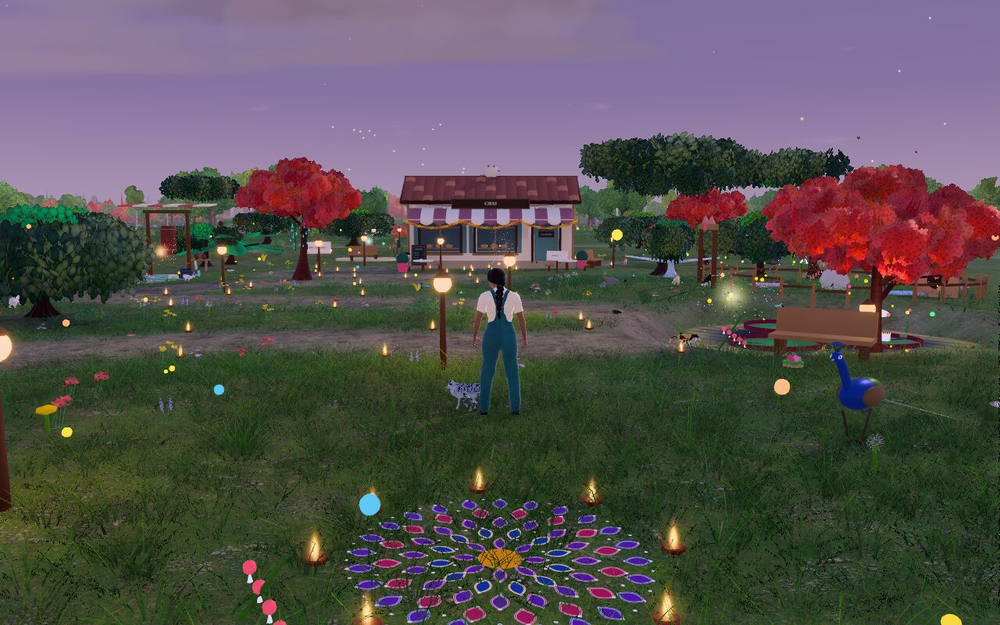
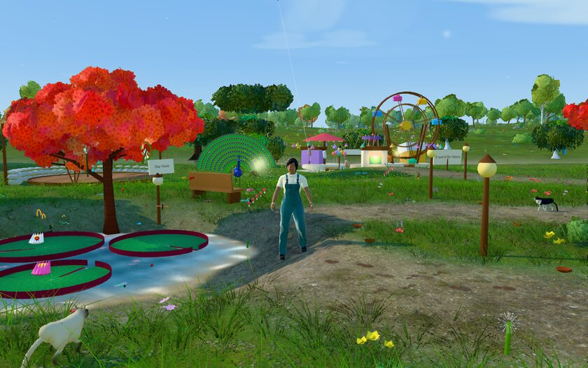
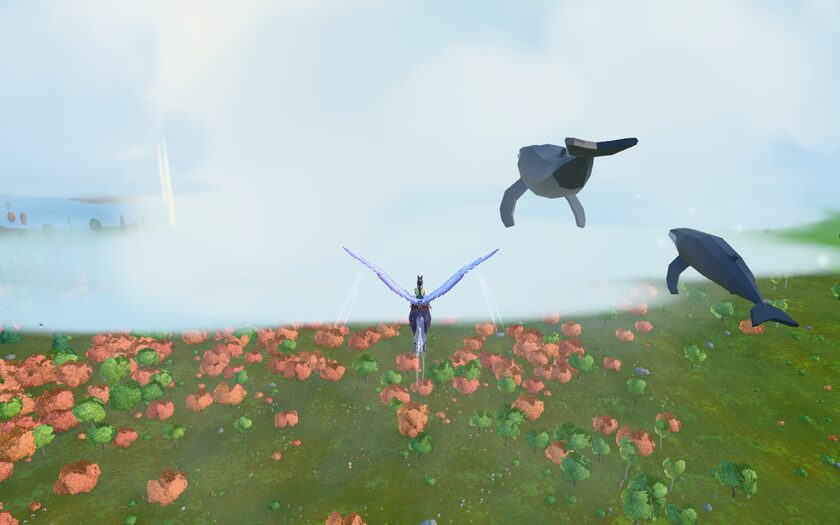
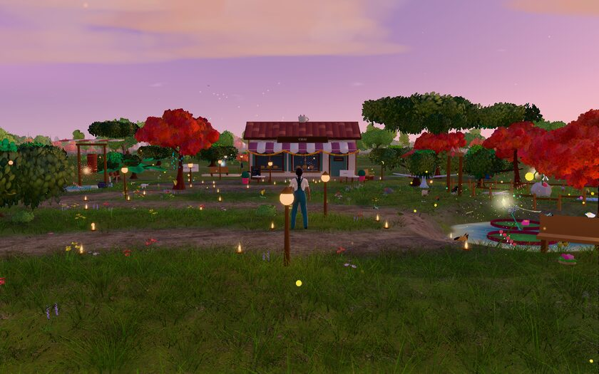
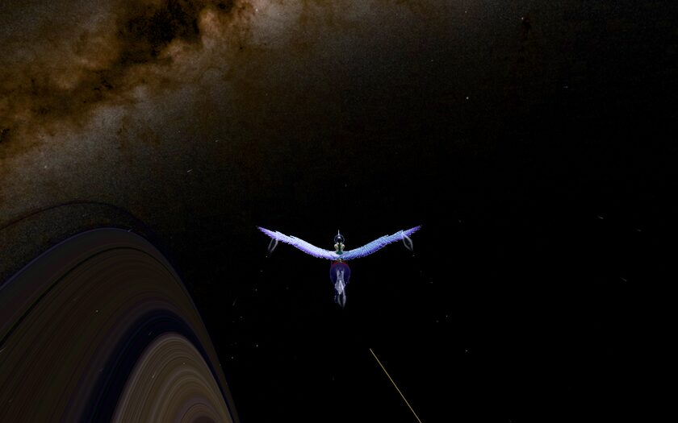
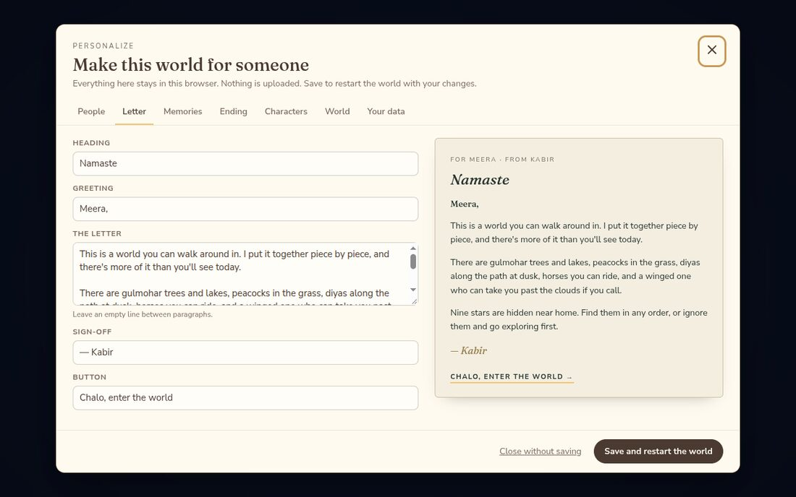

<h1 align="center">Somewhere, For You</h1>

<p align="center">
An explorable 3D world in the browser, rooted in Indian traditions, that you can make for someone:<br/>
their name on the letter that opens it, your memories at nine places around home,<br/>
and a sky full of stars to ride out into.
</p>

<p align="center">

</p>

It is two things at once:

- **A game you can play right now.** Walk, ride, fly and sail through an endless landscape, from meadows and lakes to a mountain valley, the Moon and the planets. It works out of the box with a complete demo world.
- **A starting point for a gift.** Give it to a partner, a friend, a parent or a sibling: change the names, write the letter, put your photos at the memory places, pick or import the characters and choose the music. You can do it in the browser without code, or in a config file if you build it yourself.

> **Status:** a complete, playable desktop web game (version 1.0.0). It is
> built and tested in Chromium-based desktop browsers. Phones and tablets are
> not supported. See [Browser support](#browser-support).

## Contents

- [What's in the world](#whats-in-the-world)
- [Play it](#play-it)
- [Make it for someone](#make-it-for-someone)
- [Controls](#controls)
- [Built with](#built-with)
- [Browser support](#browser-support)
- [Documentation](#documentation)
- [Contributing](#contributing)
- [How this was made](#how-this-was-made)
- [License](#license)

## What's in the world

| | |
|---|---|
|  |  |
|  |  |

- **Rooted in India.** Flame-red gulmohar trees, clay diyas that light up along the path at dusk and go out in the rain, rangoli at the thresholds, marigold torans on the gateways, patang kites on dry days, peacocks that fan their trains when you come close, a chai stall, a mela, and the first rain of the monsoon. The demo's people, animals and memory places have Indian names, home on the globe is the centre of India, a Himalayan valley waits to the north, and the Moon has the Chandrayaan landing sites. The occasion can be Diwali, Holi, Eid, Christmas, Navratri, Onam, Pongal, Baisakhi, Raksha Bandhan or Gurpurab as well as a birthday or anniversary. All of it can be changed. Two things are not Indian yet: the default music is a CC0 lo-fi track (bring your own raga or bansuri piece in the Personalize screen), and the default characters wear modern clothes rather than traditional dress, because no suitably licensed rigged outfits were available.
- **An endless landscape** streamed around you as you go: forests, meadows, lakes and rivers, and a high Himalayan-style valley with a village. Weather changes from sun to showers, storms, mist and snow, and a real star catalogue fills the night sky.
- **Two people and a cat.** You play as the explorer, with a cat who follows, plays and finds things. After the last memory the companion joins you: hold hands, hug, high-five, dance, or switch and play as them (Q).
- **Animals** that live their own lives: 15 kinds of deer with fawns, foxes, rabbits, monkeys, big cats, ducks, birds, insects, frogs and fish.
- **Horses and flight.** Seven horse breeds you can ride at walk, trot, canter and gallop. Three winged horses that take off, dash, stoop, land and do aerobatics. A golden dragon you can call down and ride.
- **Space.** The star-born Pegasus carries you past the sky to the Moon (with its real landing sites), the planets and Saturn's rings, and brings you home again.
- **Nine memory places, two hidden finds and a closing scene** that hold the personal part: words, places, dates and photos.
- **A journal, a photo mode, a world map with marks** and fast travel.

## Play it

You need [Node.js](https://nodejs.org/) 20.19+ or 22.12+ and Git.

```bash
git clone <this repository URL> somewhere-for-you
cd somewhere-for-you
npm ci
npm run dev
```

Open the address it prints (http://localhost:5173), read the letter and press **Chalo, enter the world**.

To make a copy you can host or send (a folder of static files in `dist/`):

```bash
npm run build
npm run preview   # check the built copy at http://localhost:4173
```

The people you give it to only need a desktop browser. They don't need Node.js or anything else installed. See [docs/DEPLOYMENT.md](docs/DEPLOYMENT.md) for putting `dist/` online.

## Make it for someone

<p align="center"></p>

**Without code:** open the game and choose **Explore → Personalize this world** (or visit `/?personalize`). Set the names, write the letter and the memory texts, add photos, choose the characters, the creature names, the music and the date the sky celebrates. Then press **Save and restart the world**. Everything stays in that browser: nothing is uploaded. **Export** saves the whole world as one `.zip` that you can import on another computer.

**With code:** copy `customize/gift.example.json` to `customize/gift.json`, put your files in `customize/media/` and run `npm run build`. Your `gift.json` and media are ignored by Git, so they can't be committed by accident.

What you can change: names, the relationship and occasion, the letter, the title card, nine memory places (title, words, place, date, up to six photos each), two hidden finds, the closing card, both characters (built-in looks or your own rigged `.glb`), what they say, the animals' names, the café sign, the valley's name, music, an accent colour, home on the globe, and optional live weather.

**Photos are never turned into 3D models.** A photo appears as a photo; a 3D character must be a rigged model you provide ([docs/CHARACTER_ASSETS.md](docs/CHARACTER_ASSETS.md)).

Full guide: [docs/CUSTOMIZATION.md](docs/CUSTOMIZATION.md). What is stored where: [PRIVACY.md](PRIVACY.md).

## Controls

Press **/** in the game for the full list. The essentials:

| On foot | | Riding and flying | |
|---|---|---|---|
| W A S D / arrows | walk or swim | E | get on or off a horse or Pegasus |
| Shift | run | W S · A D | speed · steer |
| Space | jump | Space (on a Pegasus) | take off, climb |
| E | interact, look closer | C | descend |
| Mouse drag · wheel | look · zoom | Shift | dash; hold for the dragon's rush |
| Tab | camera distance | R | land into a gallop |
| C | call the cat | Y · U · I | whistle for your Pegasus · call your horse · call the star-born Pegasus |
| P | photo mode | 1 | call the golden dragon |
| L | journal | M · N · K | world map (in space, the star chart) · travel · go home |
| Q | switch character | 2 | change the weather |
| F2 | hide the extras | F5 | refresh the universe |

With the companion: **H** hold hands, **G** hug, **F** high five, **V** dance, **T** follow or wait.

## Built with

**To play:** a desktop browser with WebGL 2. Nothing to install.

**Runtime** (shipped in the game): [three.js](https://threejs.org/) (WebGL rendering), [React](https://react.dev/) with [React Three Fiber](https://r3f.docs.pmnd.rs/) and [drei](https://github.com/pmndrs/drei), [postprocessing](https://github.com/pmndrs/postprocessing) with [N8AO](https://github.com/N8python/n8ao) (bloom, ambient occlusion, colour grading), [zustand](https://zustand.docs.pmnd.rs/) (state), [Howler.js](https://howlerjs.com/) (music) and [Lucide](https://lucide.dev/) (icons). Terrain, far terrain, the horizon and map tiles are generated in Web Workers.

**Development:** TypeScript, [Vite](https://vite.dev/), [Vitest](https://vitest.dev/) (about 1,200 unit tests), [Playwright](https://playwright.dev/) (browser tests) and ESLint.

**Asset authoring** (optional, only to rebuild models): [Blender](https://www.blender.org/) with [MPFB](https://static.makehumancommunity.org/mpfb.html) for the characters, Python scripts for the horses, deer, terrain textures and sky data, and [glTF Transform](https://gltf-transform.dev/). See [asset-pipeline/](asset-pipeline/).

All models are glTF binary (`.glb`). There is no backend, no account, no analytics and no tracking.

## Browser support

| | Status |
|---|---|
| Chromium (desktop) | **Tested**: Chromium on Linux under WSLg on Windows, with an NVIDIA GTX 1660 Ti through D3D12 |
| Chrome / Edge (desktop) | Same engine as the tested build; not separately tested for this release |
| Firefox (desktop) | Not tested for this release |
| Safari (macOS) | Not tested for this release |
| Phones and tablets | **Not supported** (no touch controls) |

It is a demanding 3D scene: a dedicated graphics card is recommended. Measured on the production build with a GTX 1660 Ti, Chromium under WSLg and auto quality, standing at home: about 32 fps at 1280×800 and about 27 fps at 1920×1080. If it runs slowly, choose **Balanced** or **Light** in the HUD's quality menu. A computer without a working graphics card falls back to software rendering, which is very slow; the game tells you when that happens. More in [docs/DEVELOPMENT.md](docs/DEVELOPMENT.md#performance-and-troubleshooting).

## Documentation

| | |
|---|---|
| [docs/CUSTOMIZATION.md](docs/CUSTOMIZATION.md) | every personal setting, in the browser or in `gift.json` |
| [docs/CHARACTER_ASSETS.md](docs/CHARACTER_ASSETS.md) | the character rig, importing your own model, rebuilding the built-in ones |
| [docs/ARCHITECTURE.md](docs/ARCHITECTURE.md) | how the code is organised and how the systems fit together |
| [docs/DEVELOPMENT.md](docs/DEVELOPMENT.md) | local setup, scripts, tests, debugging, performance and troubleshooting |
| [docs/DEPLOYMENT.md](docs/DEPLOYMENT.md) | hosting your built copy, with the recommended security headers |
| [PRIVACY.md](PRIVACY.md) · [SECURITY.md](SECURITY.md) | what stays on your device · reporting a vulnerability |
| [ASSET_LICENSES.md](ASSET_LICENSES.md) | where every model, texture, font and track comes from |

## Contributing

Bug reports, fixes and new ideas are welcome. Start with [CONTRIBUTING.md](CONTRIBUTING.md); please also read the [Code of Conduct](CODE_OF_CONDUCT.md).

## How this was made

This project was designed and directed by a person and built over many iterations with AI coding assistants doing much of the implementation, among them OpenAI Codex models, Anthropic's Claude Sonnet and Claude Opus (Claude Opus 5.5 carried much of the later refinement), Google's Gemini through Antigravity, GLM and DeepSeek models, together with agent tooling for the browser and Blender. Every change was reviewed and tested in the running game; the tests in this repository are the evidence that it works, not the tools that wrote it.

## License

The code and the project's own models, textures and artwork are released under the [MIT License](LICENSE). Some bundled third-party assets have their own licences (most are CC0 or public domain; the planet textures are CC BY 4.0 and the star catalogue is CC BY-SA 4.0). They are listed with their required credits in [ASSET_LICENSES.md](ASSET_LICENSES.md).
