<h1 align="center">Somewhere, For You</h1>

<p align="center">
A 3D world that runs in your browser. Walk around it, ride horses, fly past the clouds and go all the way to the Moon.<br/>
Then change the names, the letter and the photos, and give it to someone.
</p>

<p align="center"><strong>Somewhere, For You created by Ibrahim Sultan.</strong></p>

<p align="center">
<a href="docs/media/somewhere-for-you-trailer-720p.mp4">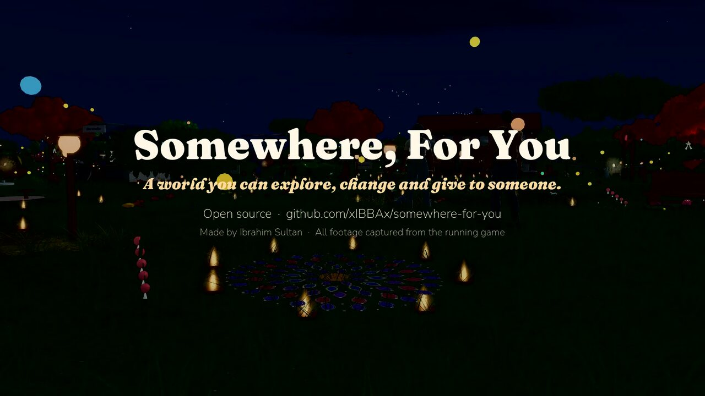</a><br/>
<a href="docs/media/somewhere-for-you-trailer-720p.mp4"><strong>▶ Download the trailer</strong></a> (MP4, 27 MB. This is real gameplay from the game.)
</p>

You can use this in two ways:

- **Just play it.** Walk, ride and fly through the world, from the meadows and lakes to the mountain valley, the Moon and the planets. The demo world works as soon as you run it.
- **Make it for someone.** A partner, a friend, a parent, a sibling, anyone. Change the names, write your own letter, put your photos at the memory places, and pick the characters and the music. You can do all of it in the browser without touching code, or in a config file if you want to build your own copy.

> **Status:** You can play it from start to finish on a desktop browser, but I'm still working on it. I've only tested it in Chromium, and phones and tablets don't work. See [Project status](#project-status) for what works and what doesn't yet.

## Contents

- [What's in the world](#whats-in-the-world)
- [Play it](#play-it)
- [Make it for someone](#make-it-for-someone)
- [Controls](#controls)
- [Built with](#built-with)
- [Project status](#project-status)
- [Browser support](#browser-support)
- [Documentation](#documentation)
- [Contributing](#contributing)
- [How this was made](#how-this-was-made)
- [License](#license)

## What's in the world

| | |
|---|---|
| 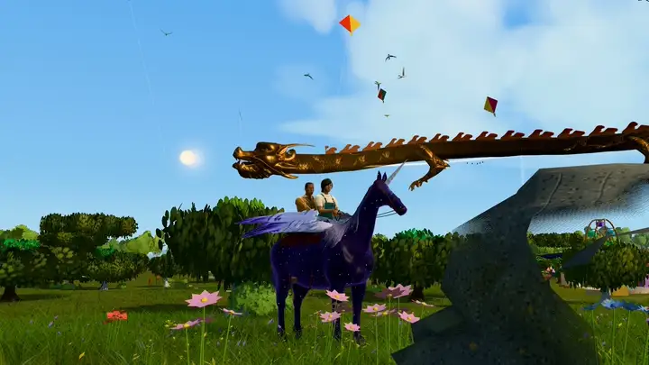<br/><sub>Taking off on the star-born Pegasus</sub> | 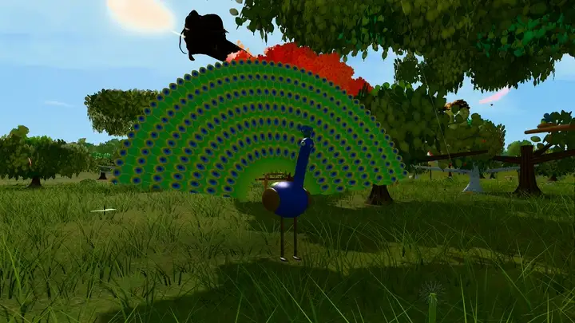<br/><sub>Peacocks fan their trains when you come close</sub> |
| 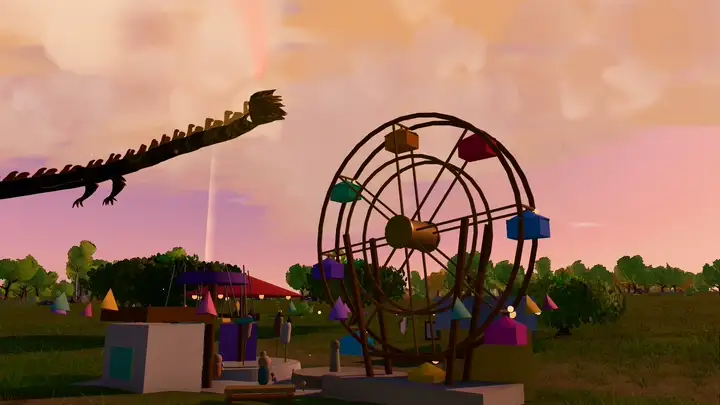<br/><sub>The mela at dusk, with the dragon passing over</sub> | 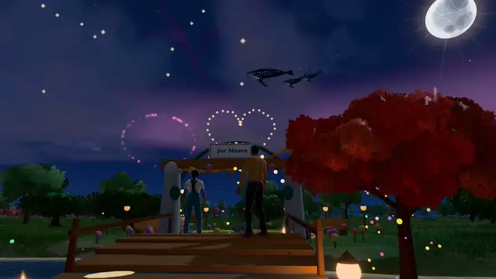<br/><sub>Fireworks over the garden gate</sub> |
| 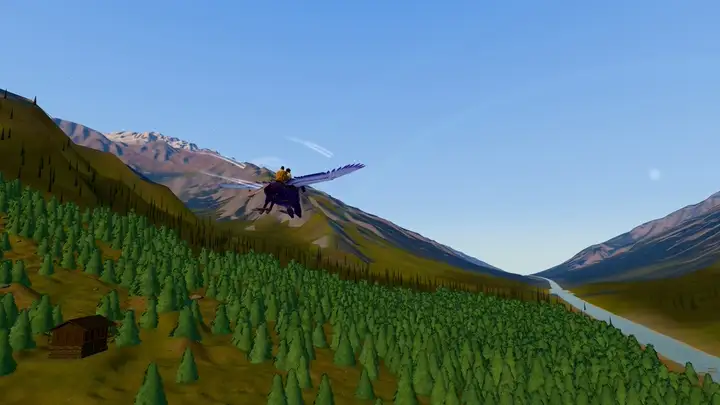<br/><sub>Flying through the mountain valley</sub> | 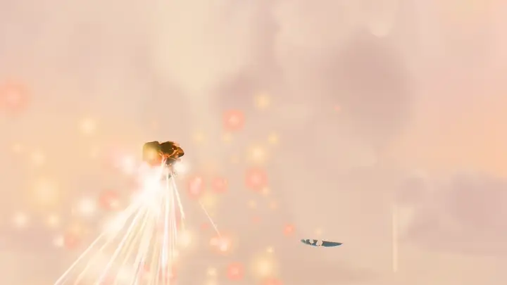<br/><sub>The dragon's golden rush</sub> |
| 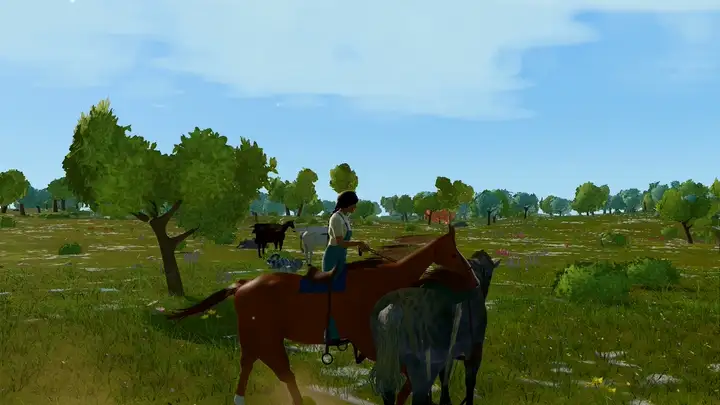<br/><sub>Seven horse breeds to ride</sub> | 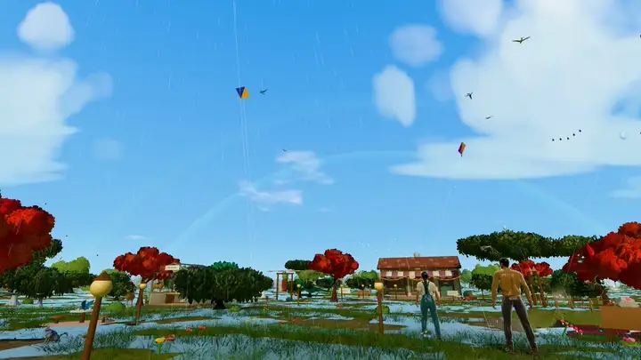<br/><sub>Kites and a rainbow after the rain</sub> |
| 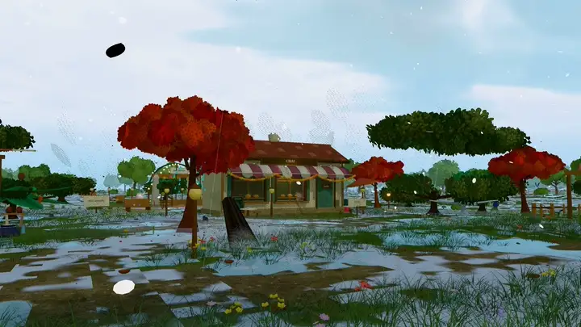<br/><sub>Weather changes: here, snow on the meadow</sub> | 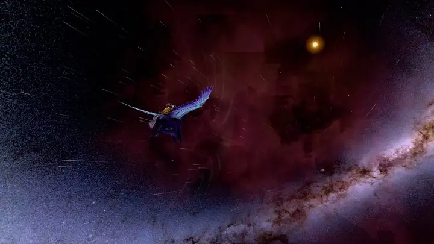<br/><sub>The star corridor opening onto the Moon</sub> |
| 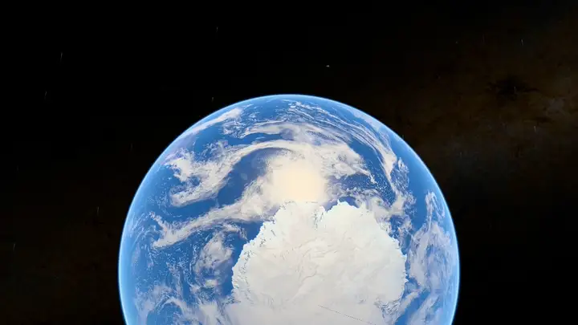<br/><sub>Earth from orbit</sub> | 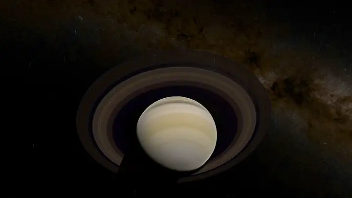<br/><sub>Saturn's rings</sub> |

- **Indian by default.** Flame-red gulmohar trees, clay diyas that light up along the path at dusk and go out in the rain, rangoli at the doorways, marigold torans, patang kites on dry days, peacocks that fan out when you get close, a chai stall, a mela and the first rain of the monsoon. The people, animals and memory places in the demo have Indian names, home on the globe is the centre of India, there's a Himalayan valley to the north, and the Moon has the Chandrayaan landing sites. You can set the occasion to Diwali, Holi, Eid, Christmas, Navratri, Onam, Pongal, Baisakhi, Raksha Bandhan or Gurpurab, or a birthday or anniversary. You can change all of this. Two things aren't Indian yet: the music is a CC0 lo-fi track (you can add your own raga or bansuri piece in the Personalize screen), and the characters wear modern clothes, because I couldn't find rigged traditional outfits with a clear licence.
- **An endless landscape** streamed around you as you go: forests, meadows, lakes and rivers, and a high Himalayan-style valley with a village. Weather changes from sun to showers, storms, mist and snow, and a real star catalogue fills the night sky.
- **Two people and a cat.** You play as the explorer, with a cat who follows, plays and finds things. After the last memory the companion joins you: hold hands, hug, high-five, dance, or switch and play as them (Q).
- **Animals** that live their own lives: 15 kinds of deer with fawns, foxes, rabbits, monkeys, big cats, ducks, birds, insects, frogs and fish.
- **Horses and flight.** Seven horse breeds you can ride at walk, trot, canter and gallop. Three winged horses that take off, dash, stoop, land and do aerobatics. A golden dragon you can call down and ride.
- **Space.** The star-born Pegasus carries you past the sky to the Moon (with its real landing sites), the planets and Saturn's rings, and brings you home again.
- **Nine memory places, two hidden finds and a closing scene** that hold the personal part: words, places, dates and photos.
- **A journal, a photo mode, a world map with marks** and fast travel.

## Play it

You need [Node.js](https://nodejs.org/) 20.19+ or 22.12+ and Git.

```bash
git clone https://github.com/xIBBAx/somewhere-for-you.git
cd somewhere-for-you
npm ci
npm run dev
```

Open the address it prints (http://localhost:5173), read the letter and press **Chalo, enter the world**.

To make a copy you can host or send (a folder of static files in `dist/`):

```bash
npm run build
npm run preview   # check the built copy at http://localhost:4173
```

The people you give it to only need a desktop browser. They don't need Node.js or anything else installed. See [docs/DEPLOYMENT.md](docs/DEPLOYMENT.md) for putting `dist/` online.

## Make it for someone

<p align="center"></p>

**Without code:** open the game and choose **Explore → Personalize this world** (or visit `/?personalize`). Set the names, write the letter and the memory texts, add photos, choose the characters, the creature names, the music and the date the sky celebrates. Then press **Save and restart the world**. Everything stays in that browser: nothing is uploaded. **Export** saves the whole world as one `.zip` that you can import on another computer.

**With code:** copy `customize/gift.example.json` to `customize/gift.json`, put your files in `customize/media/` and run `npm run build`. Your `gift.json` and media are ignored by Git, so they can't be committed by accident.

What you can change: names, the relationship and occasion, the letter, the title card, nine memory places (title, words, place, date, up to six photos each), two hidden finds, the closing card, both characters (built-in looks or your own rigged `.glb`), what they say, the animals' names, the café sign, the valley's name, music, an accent colour, home on the globe, and optional live weather.

**Photos are never turned into 3D models.** A photo appears as a photo; a 3D character must be a rigged model you provide ([docs/CHARACTER_ASSETS.md](docs/CHARACTER_ASSETS.md)).

Full guide: [docs/CUSTOMIZATION.md](docs/CUSTOMIZATION.md). What is stored where: [PRIVACY.md](PRIVACY.md).

## Controls

Press **/** in the game for the full list. The essentials:

| On foot | | Riding and flying | |
|---|---|---|---|
| W A S D / arrows | walk or swim | E | get on or off a horse or Pegasus |
| Shift | run | W S · A D | speed · steer |
| Space | jump | Space (on a Pegasus) | take off, climb |
| E | interact, look closer | C | descend |
| Mouse drag · wheel | look · zoom | Shift | dash; hold for the dragon's rush |
| Tab | camera distance | R | land into a gallop |
| C | call the cat | Y · U · I | whistle for your Pegasus · call your horse · call the star-born Pegasus |
| P | photo mode | 1 | call the golden dragon |
| L | journal | M · N · K | world map (in space, the star chart) · travel · go home |
| Q | switch character | 2 | change the weather |
| F2 | hide the extras | F5 | refresh the universe |

With the companion: **H** hold hands, **G** hug, **F** high five, **V** dance, **T** follow or wait.

## Built with

**To play:** a desktop browser with WebGL 2. Nothing to install.

**Runtime** (shipped in the game): [three.js](https://threejs.org/) (WebGL rendering), [React](https://react.dev/) with [React Three Fiber](https://r3f.docs.pmnd.rs/) and [drei](https://github.com/pmndrs/drei), [postprocessing](https://github.com/pmndrs/postprocessing) with [N8AO](https://github.com/N8python/n8ao) (bloom, ambient occlusion, colour grading), [zustand](https://zustand.docs.pmnd.rs/) (state), [Howler.js](https://howlerjs.com/) (music) and [Lucide](https://lucide.dev/) (icons). Terrain, far terrain, the horizon and map tiles are generated in Web Workers.

**Development:** TypeScript, [Vite](https://vite.dev/), [Vitest](https://vitest.dev/) (about 1,200 unit tests), [Playwright](https://playwright.dev/) (browser tests) and ESLint.

**Asset authoring** (optional, only to rebuild models): [Blender](https://www.blender.org/) with [MPFB](https://static.makehumancommunity.org/mpfb.html) for the characters, Python scripts for the horses, deer, terrain textures and sky data, and [glTF Transform](https://gltf-transform.dev/). See [asset-pipeline/](asset-pipeline/).

All models are glTF binary (`.glb`). There is no backend, no account, no analytics and no tracking.

## Browser support

| | Status |
|---|---|
| Chromium (desktop) | **This is what I test on:** Chromium on Linux under WSLg on Windows, with an NVIDIA GTX 1660 Ti |
| Chrome / Edge (desktop) | Same engine, but I haven't tested them separately yet |
| Firefox (desktop) | I haven't tested it yet |
| Safari (macOS) | I haven't tested it yet |
| Phones and tablets | **Doesn't work** (there are no touch controls) |

It's a heavy 3D scene, so you'll want a dedicated graphics card. On my GTX 1660 Ti, standing at home on auto quality in the production build, I get about 32 fps at 1280×800 and about 27 fps at 1920×1080. If it's slow for you, pick **Balanced** or **Light** in the quality menu. Without a working graphics card it falls back to software rendering, which is very slow, and the game will tell you when that happens. There's more in [docs/DEVELOPMENT.md](docs/DEVELOPMENT.md#performance-and-troubleshooting).

## Project status

It's not perfect and it's not finished. This is where it stands right now.

| | |
|---|---|
| **Works, I've played and tested it** | Walking, running and jumping · horses · the three winged horses and the dragon · home, the wider world and the mountain valley · weather, day and night · the trip to the Moon, the planets and back · the companion and the things you do together · photo mode, journal, world map and fast travel · the Personalize screen, including photos, export, import and deleting everything |
| **Experimental** | Your own rigged 3D character: the upload check is tested, but I haven't played the whole game with one yet · live weather (optional, off by default) |
| **Not tested yet** | Firefox, Safari, and Chrome or Edge directly on Windows |
| **Known problems** | Hand and foot placement on slopes and saddles can be about 14 cm off · it's heavy on mid-range graphics cards · water contact and animal behaviour have automated tests but need more real play · I haven't measured memory use over very long sessions |
| **What I want to do next** | Traditional clothes and an Indian classical soundtrack, once I find properly licensed assets · better foot placement · a lighter first load |

The [open issues](https://github.com/xIBBAx/somewhere-for-you/issues) are a good place to start. If you're a developer, designer, 3D artist or animator and you want to help, I'd really like that. And if you just want to clone it and make it your own, that's great too.

## Documentation

| | |
|---|---|
| [docs/CUSTOMIZATION.md](docs/CUSTOMIZATION.md) | every personal setting, in the browser or in `gift.json` |
| [docs/CHARACTER_ASSETS.md](docs/CHARACTER_ASSETS.md) | the character rig, importing your own model, rebuilding the built-in ones |
| [docs/ARCHITECTURE.md](docs/ARCHITECTURE.md) | how the code is organised and how the systems fit together |
| [docs/DEVELOPMENT.md](docs/DEVELOPMENT.md) | local setup, scripts, tests, debugging, performance and troubleshooting |
| [docs/DEPLOYMENT.md](docs/DEPLOYMENT.md) | hosting your built copy, with the recommended security headers |
| [PRIVACY.md](PRIVACY.md) · [SECURITY.md](SECURITY.md) | what stays on your device · reporting a vulnerability |
| [ASSET_LICENSES.md](ASSET_LICENSES.md) | where every model, texture, font and track comes from |

## Contributing

Bug reports, fixes and new ideas are all welcome. Start with [CONTRIBUTING.md](CONTRIBUTING.md), and please read the [Code of Conduct](CODE_OF_CONDUCT.md) too.

## How this was made

**Somewhere, For You created by Ibrahim Sultan.**

This was my idea and I've been building it for a long time. I used LLMs, coding agents, skills, plugins, MCP servers, browser automation and Blender to do it. Codex, Claude Sonnet, Claude Opus, Gemini through Antigravity, GLM and DeepSeek all helped, and Claude Opus 5.5 did a lot of the later refinement and integration.

AI wrote a lot of the code. I came up with the idea, decided what goes in, played it, tested it and kept going back until it felt right.

## License

The code and my own models, textures and artwork are under the [MIT License](LICENSE). Some third-party assets have their own licences (most are CC0 or public domain, the planet textures are CC BY 4.0 and the star catalogue is CC BY-SA 4.0). They're all listed with their credits in [ASSET_LICENSES.md](ASSET_LICENSES.md).

---

<sub>Somewhere, For You created by <a href="https://github.com/xIBBAx">Ibrahim Sultan</a>.</sub>
