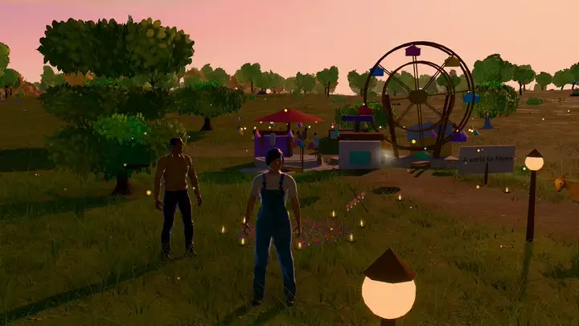

# Security policy

## Supported versions

I fix security problems on the `main` branch and in the latest release. I don't
update older releases.

## Reporting a vulnerability

Please report security problems **privately**, not in a public issue:
use GitHub's private vulnerability reporting for this repository
(**Security → Report a vulnerability**). I'll reply within a week. If it's a real
problem, I'll fix it privately and credit you in the release notes unless you'd
rather I didn't.

Useful things to include: what an attacker could do, the steps or a small
file that triggers it (a crafted `gift.json`, `.zip` or `.glb`, for example),
and the browser and version.

## Scope

In scope:

- The game and its Personalize screen: anything that lets a crafted
  `gift.json`, exported `.zip`, photo, track or `.glb` model run script,
  read other files, escape its validation or freeze the page.
- The build tools in this repository (`tools/vite/`, `asset-pipeline/`) when
  run on untrusted input as documented.
- The GitHub Actions workflows.

Out of scope: problems that need the attacker to already control the
victim's browser or computer, denial of service by deliberately loading very
large but valid worlds into your own browser, and issues in third-party hosts.

## How I keep it safe

- No backend, no accounts, no secrets in the client, no analytics.
- Personal text is only ever inserted as text, never as HTML.
- Every added file is size-limited and checked by its contents; photos are
  re-encoded, archives are read with path and size checks, models are parsed
  locally and checked before use.
- The production build ships no debug tools, no source maps, and works under
  the strict Content Security Policy in
  [`tools/vite/securityHeaders.ts`](tools/vite/securityHeaders.ts).
- Dependencies are pinned in `package-lock.json` and watched by Dependabot;
  CI runs with read-only permissions and pinned actions.

---

Somewhere, For You created by <a href="https://github.com/xIBBAx">Ibrahim Sultan</a>.
