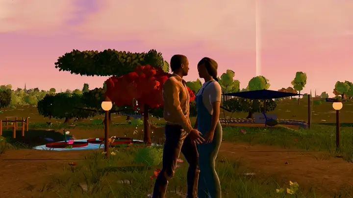

# customize/

Put your own world here. Nothing in this folder is committed to Git except
this README, the example and `media/README.md` (see `.gitignore`).

1. Copy `gift.example.json` to `gift.json` and edit it.
2. Put photos, a music track or character models in `media/`, and refer to
   them from `gift.json` as `"media:<path inside media>"`, for example
   `"media:photos/lake.jpg"`.
3. Run `npm run dev` to see it, or `npm run build` to make a copy you can host.

You can also personalize without code: open the game, choose **Explore →
Personalize this world**, and export the result. An exported `.zip` has
exactly this layout (`gift.json` + `media/`), so you can unzip it here.

Every field is explained in [docs/CUSTOMIZATION.md](../docs/CUSTOMIZATION.md).

---

Somewhere, For You created by <a href="https://github.com/xIBBAx">Ibrahim Sultan</a>.
