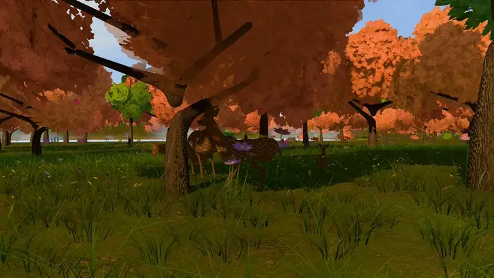

# customize/media/

Your photos (`.jpg`, `.png`, `.webp`), music (`.mp3`, `.ogg`, `.m4a`, `.wav`)
and character models (`.glb`) for `customize/gift.json`. Subfolders are fine.

This folder is ignored by Git (only this README is tracked), so personal files
stay on your machine. When you run `npm run build`, the files you reference are
copied into `dist/`, which is what you host: anyone with the link can download
them, so only include what you are happy to share with the people you send it to.

---

Somewhere, For You created by <a href="https://github.com/xIBBAx">Ibrahim Sultan</a>.
