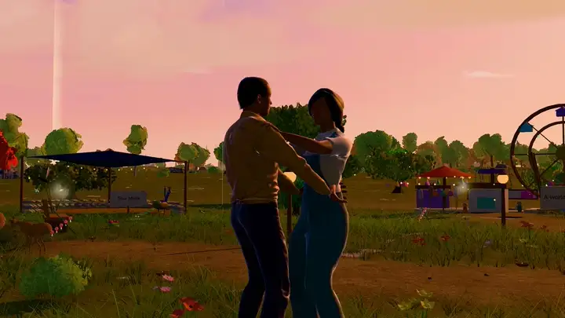
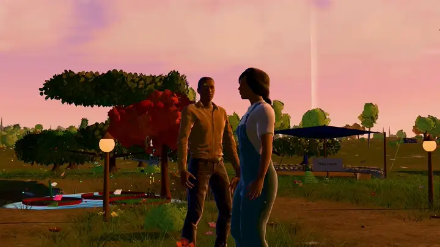

# Character assets

<p align="center"></p>
<p align="center"></p>

The two people in the world, the explorer and the companion, share one
skeleton and one animator. Nothing is pre-animated: walking, running,
swimming, riding, flying, gestures, expressions and gaze are all posed in
code every frame by `src/game/characters/human/HumanAnimator.ts`, so any
model with the right skeleton moves like the built-in ones.

There are three different things people mean by "my own character":

1. **A photo in the world.** Photos appear on memory cards, the ending card
   and the hidden finds ([CUSTOMIZATION.md](CUSTOMIZATION.md)). They are never
   turned into 3D.
2. **Your own rigged 3D model.** A `.glb` that follows the rules below. This
   page is about this.
3. **A 3D likeness made from photos.** Not part of this project. If you make
   one elsewhere (by hand in Blender, or with a 3D service under its own terms)
   and rig it as below, you can use it as (2).

## The built-in characters

`public/assets/characters/explorer.glb` and `companion.glb` are generated by
[`asset-pipeline/characters/build_human.py`](../asset-pipeline/characters/build_human.py)
from the JSON profiles beside it, using MPFB (MakeHuman for Blender) and its
CC0 assets. Each is about 2.7 MB: one skinned body with 29 ARKit face shapes,
eyes, brows, lashes, teeth, hair, an outfit and shoes, with WebP textures
(2048 px skin, 1024 px clothing).

To rebuild them, or make a new look:

```bash
# once: Blender 5.x, the MPFB extension and the MakeHuman CC0 asset packs
asset-pipeline/setup/bootstrap-authoring-tools.sh base python blender mpfb node

npm run characters                          # rebuild every profile
PREVIEW=1 bash asset-pipeline/characters/build.sh explorer   # one, with preview renders
```

A profile sets the body (MakeHuman macro and detail targets), height, skin and
tone, eyes, brows, lashes, hair and its colour, the outfit and shoes, colour
changes for the outfit by body region (`upper`, `lower` or `all`), and how
much the garment's back hem sways (`hemSway`). Any CC0 MakeHuman asset can be
used. To add a look to the game, add a profile, build it, and register it in
`CHARACTER_PRESETS` in `src/content/assets.ts`.

## Rules for your own model

Format: binary glTF 2.0 (`.glb`), up to 40 MB. One unit is one metre;
+Y up; the character faces +Z with its left hand on +X; feet on the ground at
the origin; arms down beside the body at rest, palms facing the thighs.

### Required bones

Bone names as they appear in the file (three.js removes the dots, so
`upperarm.L` and `upperarmL` both work):

| Body | Left and right |
|---|---|
| `hips`, `spine`, `chest`, `neck`, `head` | `shoulder.L/R`, `upperarm.L/R`, `forearm.L/R`, `hand.L/R`, `thigh.L/R`, `shin.L/R`, `foot.L/R` |

### Optional extras (used when present)

| Name | Gives you |
|---|---|
| `toe.L/R` | toes that roll off the ground |
| `index1-3`, `middle1-3`, `ring1-3`, `pinky1-3`, `thumb1-3` (`.L/R`) | hands that curl, hold, wave and grip reins |
| `eye.L`, `eye.R` | eyes that look at what the character looks at |
| `cape`, `cape2` (children of `chest`, hanging down the back) | clothing that sways when running and landing |
| `root` | a parent above `hips` |
| ARKit blend shapes on the face mesh: `eyeBlinkLeft`, `mouthSmileLeft`, `jawOpen`, `browInnerUp`… (the 29 in `FACE_UNITS`, `src/game/characters/faceRig.ts`) | blinking, smiles, surprise, talking |

### Materials

Meshes named `body`, `eyes`, `brows`, `lashes`, `hair`, `teeth`, `outfit` or
`shoes` (or containing those words, such as `hero_hair`) get the game's skin,
hair, eye and fabric shading, rain wetness and rim light. Anything else keeps
its own glTF material. Keep textures at 2048 px or below, prefer WebP, and
keep the whole model under about 60,000 triangles. Meshopt compression
(`EXT_meshopt_compression`) is supported; Draco and KTX2 textures are not.

### From Blender

1. Rig to the names above (rename an existing rig's bones, or start from the
   built-in characters: import `explorer.glb`, swap the mesh, weight it to the
   same skeleton).
2. Apply all transforms; put the feet at the origin; face −Y in Blender
   (which exports as +Z).
3. **File → Export → glTF 2.0**: format *glTF Binary*, *Apply Modifiers* on,
   *Skinning* on, *Shape Keys* on, *Animation* off, image format WebP.

### Checking it

Personalize → Characters → **Use my own model** checks the file locally
before using it and lists what is missing. In the browser console, a model
that fails to load explains why, and the built-in look is used instead, so the
world never loses its character.

## Licences

Only use models you have the right to redistribute if you will share your
world publicly. Mixamo characters and animations, and most marketplace models,
must not be committed to a public repository. See
[ASSET_LICENSES.md](../ASSET_LICENSES.md) and
[CONTRIBUTING.md](../CONTRIBUTING.md#assets).

---

<sub>Somewhere, For You was created by <a href="https://github.com/xIBBAx">Ibrahim Sultan</a>.</sub>
