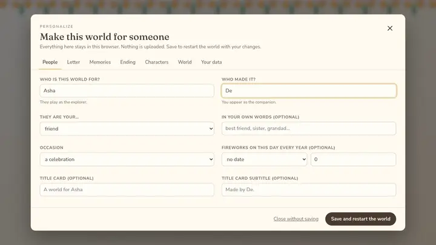
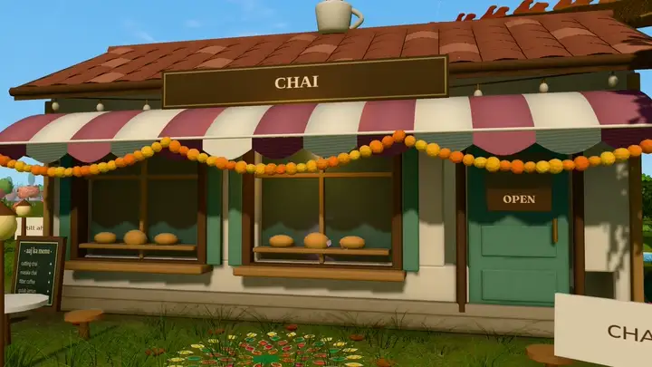
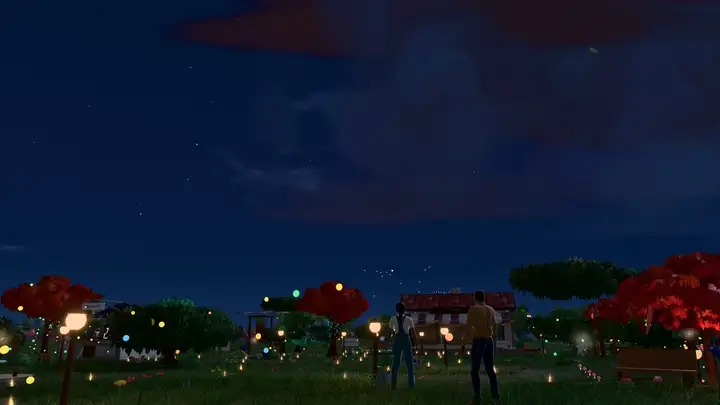

# Making the world your own

<p align="center"><br/><em>The real Personalize screen, with fictional names</em></p>
<p align="center"><br/><em>The sign over the chai stall is one of the things you can change</em></p>
<p align="center"></p>

There are two ways to personalize the world. Both change the same settings.

| | In the browser | In `customize/` |
|---|---|---|
| Who it's for | anyone | developers who build and host a copy |
| How | Explore → **Personalize this world** (or `/?personalize`) | `customize/gift.json` + `customize/media/`, then `npm run build` |
| Where it lives | this browser only (localStorage + IndexedDB) | files on your computer, built into `dist/` |
| To share it | **Export** a `.zip`; the other person imports it in their browser | host `dist/` and send the link |

If both exist, what was saved in the browser wins over `gift.json`, which wins
over the built-in demo. Every value is checked when it loads: anything
missing or of the wrong type falls back to the default, too-long text is shortened, and the
Personalize screen lists what was replaced.

## Quick start with a file

```bash
cp customize/gift.example.json customize/gift.json
# put photos in customize/media/photos/, a track in customize/media/music/ …
npm run dev
```

Refer to a file in `customize/media/` as `"media:<path>"`, for example
`"media:photos/the-lake.jpg"`. Built-in artwork is `"placeholder:<name>"`
(`meadow`, `lake`, `path`, `studio`, `garden`, `horses`, `cafe`, `rain`,
`night`, `whales`, `lakeside`, `pegasus`).

A line written as `"[Replace with …]"` is left out of memory cards, hidden finds
and the journal. The letter, the ending, the chatter and titles show your text
exactly as written, so remove any prompts there.

## People and occasion

```json
"recipient": { "name": "Anaya" },
"creator": { "name": "Rohan" },
"relationship": { "kind": "family", "label": "little sister" },
"occasion": { "kind": "birthday", "month": 3, "day": 21 }
```

- **recipient** plays as the explorer; **creator** appears as the companion.
- **relationship.kind** is `partner`, `friend`, `family` or `other`. Nothing
  in the default text assumes romance; the label is for your own words.
- The demo's home on the globe is Nagpur, the centre of India; change `world.home` to move it.
- **occasion.kind** is `birthday`, `anniversary`, `celebration`, a festival (`diwali`, `holi`, `eid`, `christmas`, `navratri`, `onam`, `pongal`, `baisakhi`, `raksha-bandhan`, `gurpurab`) or `none`. Many festivals follow lunar or solar calendars and move each year, so set `month` and `day` to this year's date.
  With a `month` and `day` (both set, or both `0`), fireworks fill the evening
  sky on that day every year and the line in `ending.fireworksLine` (or a
  matching default) appears.

## The letter and the title card

```json
"letter": {
  "heading": "Before you begin",
  "greeting": "Anaya,",
  "paragraphs": ["…", "…"],
  "signoff": "— Rohan",
  "enter": "Go on, then"
},
"title": { "heading": "", "subtitle": "" }
```

The letter is the first thing the person sees; the world loads behind it.
Up to 8 paragraphs of up to 900 characters. Line breaks inside a paragraph are
kept. An empty title heading becomes "A world for *recipient*".

## The nine memory places

`memories` is a list of nine entries, in this order, each tied to a place near
home that already has its little scene built around it:

| # | Place | Its scene |
|---|---|---|
| 1 | the first step, by the start sign | the beginning |
| 2 | a table near the café | a café table |
| 3 | the walking path | a walk |
| 4 | the little studio | a desk, paper and a lamp |
| 5 | the cat garden | cats |
| 6 | the training corner | a training post |
| 7 | the corner café | the café with its sign |
| 8 | the umbrella spot | rain |
| 9 | the path past the last lamppost | the way ahead |

Each entry:

```json
{
  "title": "The Lake Trip",
  "subtitle": "the year it rained",
  "text": "What happened, or what it means.",
  "more": "An optional second paragraph.",
  "place": "Where (optional)",
  "date": "When (optional)",
  "photos": [{ "src": "media:photos/lake.jpg", "alt": "A lake at dusk with hills behind it", "caption": "May 2024" }]
}
```

Up to six photos per place; the first one develops on the card, the others are
small prints underneath. Always write `alt`: it is read aloud by screen
readers. The titles also name the places on the world map.

You only need to write the places you want to change: missing entries keep
the demo's words.

## Hidden finds and the ending

```json
"secrets": [
  { "title": "Under the Stairs", "text": "…", "photo": { "src": "media:photos/silly.jpg", "alt": "…" } },
  { "title": "The Blurry One", "text": "…", "photo": null }
],
"ending": {
  "heading": "", "lines": ["That's all nine.", "…"], "closing": "Come back whenever you like.",
  "photos": [{ "src": "media:photos/us.jpg", "alt": "…" }], "fireworksLine": ""
}
```

The cat finds the two secrets on a paw-print trail. Once all nine stars are
found, a lantern path leads to the garden, where the ending plays: the card's
`heading` (default "For *recipient*"), its lines and up to four photos, then
the closing line. After that the companion joins you in the world.

## Characters

```json
"characters": {
  "explorer": { "name": "", "preset": "explorer", "model": "" },
  "companion": { "name": "", "preset": "companion", "model": "", "follows": true, "chatter": "sometimes" }
},
"chatter": { "explorer": ["…"], "companion": ["…"] }
```

- **name**: shown in the world; empty uses the recipient's or creator's name.
- **preset**: a built-in look (`explorer` or `companion`; either role may use
  either look).
- **model**: your own rigged `.glb` (`"media:characters/me.glb"`, or imported
  in the browser). It must have the skeleton described in
  [CHARACTER_ASSETS.md](CHARACTER_ASSETS.md); if it doesn't, the preset is
  used and the console says why.
- **follows**: whether the companion walks with you by default (T toggles it).
- **chatter**: how often the companion speaks up: `often`, `sometimes`,
  `rarely`. The `chatter` lists are what each one may say.

**A photo is never turned into a 3D model.** Making a 3D likeness of someone
is a separate job (in Blender, or a 3D service of your choice and under its
terms); the game only uses models you provide.

## The animals and the places

```json
"creatures": {
  "starborn": "Ashwini", "explorerPegasus": "Chandni", "companionPegasus": "Megh",
  "dragon": "Swarna", "cat": "Chikoo",
  "spaceCats": ["Surya", "Chanda", "Mangal", "Badal", "Jyoti"]
},
"places": {
  "cafeSign": "CHAI", "studioLine": "", "cafeLine": "",
  "valleyName": "Devdar Valley", "benchName": "The valley bench"
}
```

Every named creature and place can be renamed. `studioLine` and `cafeLine`
add a closing line to those two memory cards. The café sign is short (16
characters).

### Swapping places for your own

The world's places are built in code, so you can change more than their names:

- **The memory places' words and photos** are the nine `memories` above. Their
  set pieces (the café, the studio, the garden…) live in
  `src/game/environment/` and their positions in `src/content/memories.ts`.
- **Adding a place of your own**, such as a building that matters to you:
  add a site to `SITES` in `src/world/sites/siteLayout.ts` (a position,
  rotation and flat radius), then render your model there the way the
  village does in `src/world/highvale/render/HighvaleVillage.tsx`. The
  terrain flattens under it, nothing wild grows on it, and its footprint
  polygons in `src/world/sites/sites.ts` become solid for walking and the
  camera. Use your own model or a CC0 one. Be careful with recognisable real
  places if the world will be public.
- **The mountain valley**: its name is `places.valleyName`; its terrain,
  village and river are data in `public/assets/highvale/` and
  `src/world/highvale/`.

## Music, colour, home and weather

```json
"music": { "src": "media:music/our-song.mp3", "title": "Our Song", "credit": "…" },
"theme": { "accent": "#f2c46d" },
"world": { "home": { "label": "a little town", "latitude": 51.5, "longitude": -0.1 }, "liveWeather": false }
```

- **music.src**: `default` (the built-in track), `none`, a file
  (`.mp3`, `.ogg`, `.m4a`, `.wav`, 25 MB at most) or one added in the
  browser. Only use music you have the right to share.
- **theme.accent**: a colour for the letter and the Personalize screen.
- **world.home**: where the opening journey's globe turns to and the night
  sky's latitude. A rough location is enough; it is not sent anywhere.
- **world.liveWeather**: fetches the real weather from Open-Meteo using the
  browser's location (it asks first). Off by default; see
  [PRIVACY.md](../PRIVACY.md).

## Limits

| | |
|---|---|
| Photo | JPEG, PNG or WebP, 25 MB and 60 megapixels at most; stored at 1600 px with a 480 px thumbnail |
| Music | MP3, OGG, M4A or WAV, 25 MB |
| Character model | binary glTF (`.glb`), 40 MB |
| Exported world | `.zip`, 400 MB, 300 files |
| Names | 40 characters; titles 90; paragraphs 900 |

## Exporting, importing and starting over

Personalize → **Your data**:

- **Export this world** saves `my-world.zip` (`gift.json` + `media/`). Unzip it
  into `customize/` to build it.
- **Import a world** reads such a file; every photo, track and model is checked
  again on the way in.
- **Start the journey over** forgets progress but keeps the personalization.
- **Delete everything personal** removes it all from this browser.

---

<sub>Somewhere, For You created by <a href="https://github.com/xIBBAx">Ibrahim Sultan</a>.</sub>
